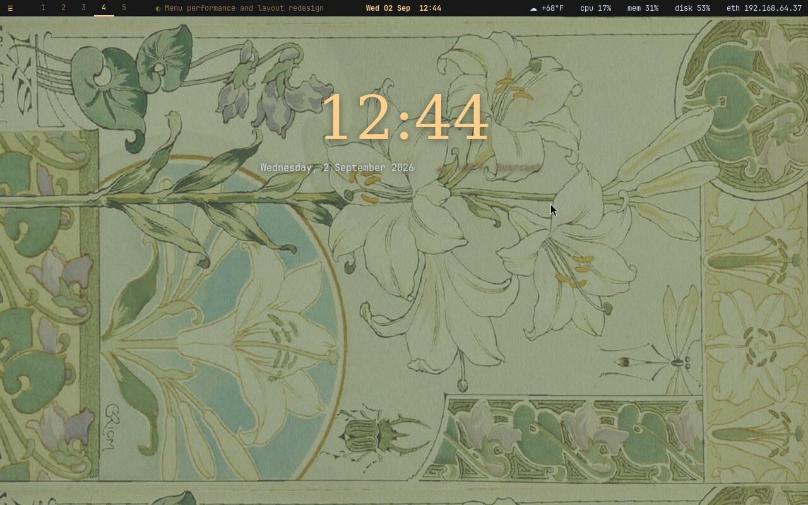
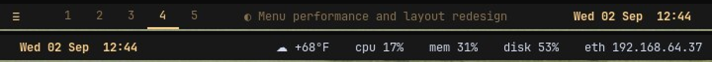
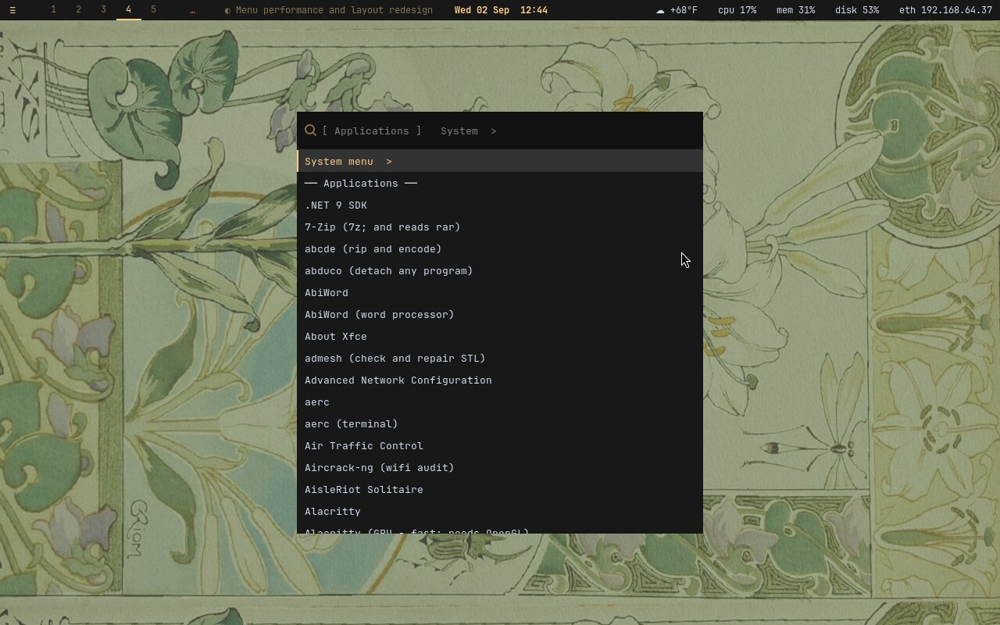
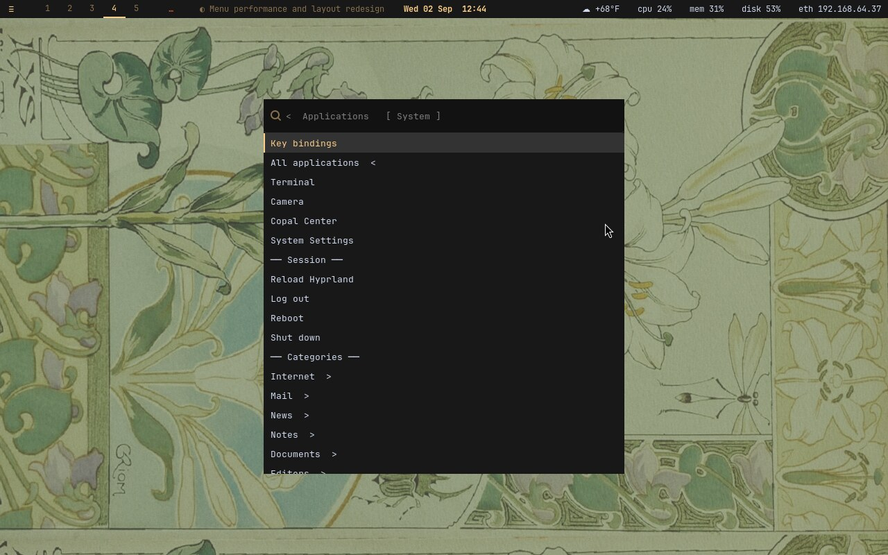
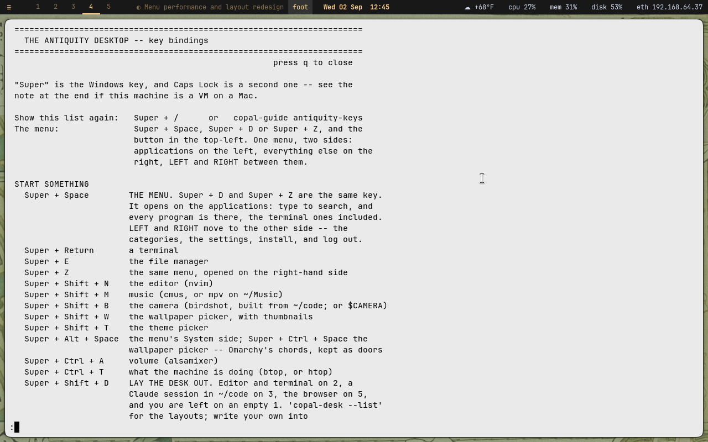
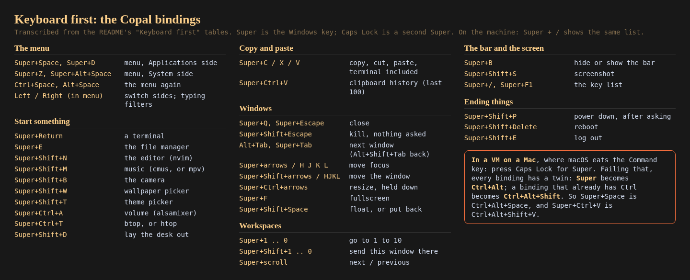
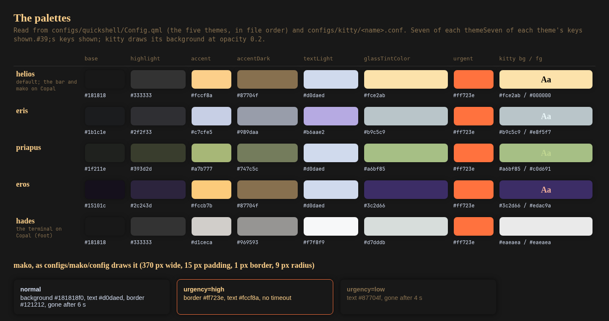
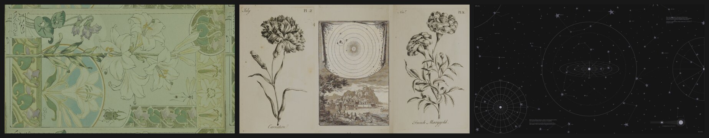

# Linux Antiquity for Copal — feature guide

A tour of the desktop in pictures: what each part is, why it exists, and how it fits the whole. Written on 2026-10-20 from this repository alone: the [README](../README.md), `install.sh` and `configs/`.

> **Whose work this is.** The look is entirely [diinki](https://github.com/diinki)'s: the [Linux Antiquity](https://github.com/diinki/linux-antiquity) theme, its art nouveau and old scientific drawing, its suns, moons, star charts and humours, its palettes and its wallpapers. This branch carries that look onto [Copal Linux](https://github.com/vonglurt/copal) (stock Alpine on a Raspberry Pi, a PC or a UTM guest; no systemd, often no GPU) and makes every part of it reachable from the keyboard. The theme is MIT. To see it as its author intended, go to the original, watch the [video](https://www.youtube.com/watch?v=qOoWQeIGKiA), and [tip diinki](https://ko-fi.com/diinki).

**Where the pictures come from.** Figures 1, 3, 4 and 5 are the repository's own screenshots, copied unchanged from `screenshots/copal/` (Alpine 3.24 in a UTM guest, on llvmpipe, 1280×800). Figure 2 is a crop of figure 1, enlarged. Figure 8 is the three images in `configs/hypr/wallpapers_bundled/`, scaled down side by side. Figures 6 and 7 are reference cards rendered for this guide with headless Chromium: 6 is transcribed from the README's key tables, 7 is read from `configs/quickshell/Config.qml`, `configs/kitty/*.conf` and `configs/mako/config`. They are drawings of the configuration, not screenshots of a running desktop. No desktop could be run to make this guide, so there is no picture of the installer at work.

## Contents

1. [The desktop, and whose it is](#part-1)
2. [Installing: Copal's installer, not upstream's script](#part-2)
3. [The bar](#part-3)
4. [The menu: one window, two sides](#part-4)
5. [Keyboard first](#part-5)
6. [The windows: thin borders, round corners](#part-6)
7. [Colours, and the notifications that use them](#part-7)
8. [The wallpapers](#part-8)
9. [What was left out, and why](#part-9)
10. [How it fits together](#part-10)

## 1. The desktop, and whose it is

**Why it exists.** Copal needed a desktop that looks like something, on machines that often have no GPU. diinki's theme had the look; this branch keeps the look and changes only what Alpine and a missing GPU force.

**How it fits.** Every other part of this guide is a piece of this one screen: the wallpaper, the bar along the top, and windows drawn in the theme's palette.

*Figure 1. The Copal desktop. Alpine 3.24 in a UTM guest, on llvmpipe: no GPU anywhere in this picture.*

1. The wallpaper: upstream's `georges_riom_collage.png`, the one `hyprpaper.conf` names.
2. The clock, date and weather painted over it.
3. The bar along the top (part 3).

**Check yourself.**
- The design is diinki's; what Copal adds is the menu, the keyboard and the port.
- It runs on llvmpipe, without a GPU.

## 2. Installing: Copal's installer, not upstream's script

**Why it exists.** Upstream's `install.sh` is written for Arch: it looks for packages Alpine does not have. Copal installs the theme its own way, so that the same tree works on every card it writes.

**How it fits.** Install is the only step where this tree is touched, and it is never edited in place: every Alpine-shaped change is a generated file or a `sed` against the installed copy. That is why `diff -r` against upstream `main` shows only deliberate deletions.

**On Copal.** Copal's installer carries this tree onto the boot partition of every card it writes and installs it as its "full monty" desktop level, stage 16. From a running Copal machine, run `copal` and choose 16, or the guided install's "full" level. The pieces land where upstream put them, translated:

| Path | What it holds |
| --- | --- |
| `~/.config/hypr/hyprland.conf` | the key bindings and the theme's rules, translated from upstream's `hyprland.lua` |
| `~/.config/hypr/LICENSE.linux-antiquity` | the MIT notice, which travels with every copy |
| `~/.config/waybar/` | the bar, in the *helios* palette |
| `~/.config/wofi/style.css` | the launcher and the menu |
| `~/.config/foot/foot.ini` | the terminal, in the *hades* palette |
| `~/.config/mako/` | notifications, upstream's config |
| `copal-guide antiquity-keys` | the key list, in a terminal |

**Upstream's script, for reference** (do not run it on Copal). `install.sh` checks for Hyprland first and stops if it is missing, then for `hyprpaper`, `nemo`, `kitty`, `quickshell`, `hyprshot`, `mako`, `jq` and `socat`, printing an `apt` or `pacman` hint for any that are missing. It then copies each directory under `configs/` into `~/.config/`, first moving any existing one into `~/<user>_BACKUPS/` (with a timestamp if a backup is already there).

**Check yourself.**
- On Copal, the theme comes with stage 16; `install.sh` is left exactly as upstream wrote it.
- Copal's lab report on the port is `docs/THEME.md` in the [Copal repository](https://github.com/vonglurt/copal).

## 3. The bar

**Why it exists.** Upstream's bar is a radial quickshell bar, and quickshell is not packaged on Alpine. The bar on Copal is waybar, painted in the *helios* palette, so the desktop keeps a status line in the theme's colours.

**How it fits.** The button at the left opens the menu (part 4), but nothing is reachable *only* that way. `Super` + `B` hides or shows the bar.

*Figure 2. The bar from figure 1, cropped and enlarged 2×, in two overlapping halves (the clock appears in both).*

1. The menu button.
2. Workspaces 1 to 5, the current one underlined.
3. The focused window's title.
4. The date and the clock, in the *helios* accent `#fccf8a`.
5. The weather, CPU, memory, disk and network.

## 4. The menu: one window, two sides

**Why it exists.** A keyboard desktop lives or dies by its launcher. The menu is shaped like Omarchy's: one window with two sides, applications on the left and everything else on the right, so there is one thing to remember.

**How it fits.** It replaces upstream's radial launcher and tarot power menu, using wofi, painted in the palette. Session entries (reload, log out, reboot, shut down) sit at the top level of the System side.

| Applications | System |
| --- | --- |
|  |  |

*Figure 3 (left). `Super` + `Space`: the Applications side. Every program on the machine, terminal ones included, each with a word on what it is.*
*Figure 4 (right). `Super` + `Z`: the System side. The key list, the terminal, the camera, Copal Center, the settings, then the session, then the categories.*

1. The header shows which side is open, in brackets.
2. `Left` and `Right` switch sides from inside the picker; typing filters.
3. Each side has an entry that leads to the other: *System menu* on the left, *All applications* on the right.

**It opens at once.** The list is built from what is installed (the catalogue, the `.desktop` files, the projects and the guides) and cached, one file per session type. From the cache it opens in about 0.2 s; the first version rebuilt the list on every press and took 4.3 s on the same guest. A `stat` on each source tells the cache it is stale; a stale list is shown at once and rebuilt behind the picker at low priority. Installing something rebuilds it.

**The arrows work.** wofi's custom keys arm an exit code but never exit, so the menu enters a Hyprland submap while it is open and Hyprland answers the arrows. Escape closes the picker and leaves the submap, so a menu that died still leaves the keyboard as it found it.

**Check yourself.**
- `Super` + `Space` (or `Super` + `D`) opens Applications; `Super` + `Z` opens System.
- Opening from the cache takes about 0.2 s, not 4.3 s.

## 5. Keyboard first

**Why it exists.** Copal's desktop is meant to be driven without lifting a hand to the mouse. The bar button and the `Super` + drag mouse bindings exist, but nothing is reachable only that way.

**How it fits.** Every binding is the one the installed `~/.config/hypr/hyprland.conf` carries, and the same list is a keypress away: `Super` + `/` (or `Super` + `F1`) opens it in a terminal.

*Figure 5. `Super` + `/`: the key list on the machine, in foot.*

*Figure 6. The bindings on one card, transcribed from the README's tables.*

1. **Start something:** a terminal, the file manager, nvim, music, the camera, the wallpaper and theme pickers, volume, btop.
2. **Copy and paste on the same keys everywhere,** terminal included: `Super` + `C` / `X` / `V`, and `Super` + `Ctrl` + `V` for the last hundred things copied.
3. **Lay the desk out:** `Super` + `Shift` + `D` puts the editor and terminal on 2, a Claude session on 3 and the browser on 5.
4. **Windows and workspaces:** focus and move with arrows or `H` `J` `K` `L`; resize with `Super` + `Ctrl` + arrows held down (there is no resize mode).
5. The volume, mute and brightness keys do what they say, as upstream bound them.

**If this is a VM on a Mac.** The Command key arrives as `Super`, and macOS takes some chords first (Cmd+W closes the VM window, Cmd+Q quits UTM). Caps Lock is a second `Super`. Failing that, every binding has a twin: where `Super` is eaten, press `Ctrl` + `Alt`; where the binding also has `Ctrl`, press `Ctrl` + `Alt` + `Shift`.

**Check yourself.**
- Caps Lock is a second `Super`.
- `Super` + `Space` has the twin `Ctrl` + `Alt` + `Space`; `Super` + `Ctrl` + `V` has `Ctrl` + `Alt` + `Shift` + `V`.

## 6. The windows: thin borders, round corners

**Why it exists.** The theme's windows are quiet frames that let the wallpaper carry the look.

**How it fits.** Upstream's `hyprland.lua` is translated to `hyprland.conf` at install; these are its values, visible on the foot window in figure 5.

- 4 px gaps between windows and 8 px at the screen edge; a 1 px border in `#1c1c1c`, active and inactive alike; no resizing by dragging the border.
- Corners rounded at 9 px, "slightly squircle-ish" (rounding power 4), the same radius as upstream's taskbar and as the notifications.
- A soft shadow (range 12, `rgba(0,0,0,0.19)`), and blur for translucent windows.
- The dwindle layout; workspaces slide, windows and fades ease on one `smooth` curve.

## 7. Colours, and the notifications that use them

**Why it exists.** One palette ties the pieces together. Upstream defines five, each named for a god: *helios* (the default), *eris*, *priapus*, *eros* and *hades*, with a matching kitty theme for each.

**How it fits.** On Copal the bar is painted in *helios*, the terminal is foot with kitty's *hades* palette translated line for line (foot renders on the CPU, and llvmpipe is common here), and mako keeps upstream's config, which matches *helios*. `Super` + `Shift` + `T` opens the theme picker.

*Figure 7. The five palettes as `Config.qml` and the kitty themes define them, and mako's notifications as `configs/mako/config` draws them. A rendered card, not a screenshot.*

1. Every palette shares the same `urgent` orange, `#ff723e`.
2. *helios*: near-black base `#181818`, the warm accent `#fccf8a` seen on the bar's clock.
3. Notifications: top right, at most five, newest first. High urgency gets an orange border and stays until dismissed; low urgency is dimmer and leaves after 4 s.

## 8. The wallpapers

**Why it exists.** The wallpaper is most of the look: old botanical plates, art nouveau borders and a star chart.

**How it fits.** Upstream's `hyprpaper.conf` pins one image to two named monitors. On Copal, hyprpaper is used where it is packaged and swaybg otherwise, on every monitor, with upstream's image. `Super` + `Shift` + `W` opens the wallpaper picker, with thumbnails.

*Figure 8. `configs/hypr/wallpapers_bundled/`: `georges_riom_collage.png` (the default), `carnation_collage.png`, `oc_the_blackboard.png`. Each is 3840×2160; scaled down here.*

## 9. What was left out, and why

**Why it exists.** A distillation is defined as much by what it drops. Each removal has a reason, and the README's table lists them all.

**How it fits.** Copal vendors this branch's `main` as a git subtree; the tag `original-fork` marks the theme exactly as forked. Changes that prove stable can graduate into committed files here, where anyone, diinki included, can see them and take them. Nothing is sent upstream unasked.

| Upstream | On Copal | Why |
| --- | --- | --- |
| quickshell bar, radial launcher, tarot power menu | waybar and wofi | quickshell is not packaged on Alpine |
| kitty | foot (kitty too, where a GPU exists) | foot renders on the CPU |
| `hyprland.lua` | `hyprland.conf` | the Hyprland Alpine packages |
| `iconTheme/` (buuf-nestort) | removed | not MIT, so it cannot ride on a card Copal distributes |
| upstream's `screenshots/` | removed here; upstream still has them | `screenshots/copal/` is Copal's own, kept out of the tar on the card |

The quickshell configuration, its fonts and its drawings remain in `configs/quickshell/`, as upstream wrote them.

## 10. How it fits together

| Part | Comes from | Reached by | Why it exists |
| --- | --- | --- | --- |
| The look: wallpaper, palettes, frames | diinki's Linux Antiquity | always on | the whole point; Copal keeps it unchanged |
| Install | Copal's installer, stage 16 | `copal`, choose 16 | Alpine has not got upstream's packages |
| Bar | waybar in *helios* | always on; `Super` + `B` | quickshell is not on Alpine |
| Menu | wofi, cached, in a Hyprland submap | `Super` + `Space`, `Super` + `Z` | one launcher for everything, opening in about 0.2 s |
| Key list | `copal-guide antiquity-keys` | `Super` + `/` | the bindings are never more than a keypress away |
| Twin bindings | Copal | `Ctrl` + `Alt` (+ `Shift`) | macOS eats `Super` in a UTM guest |
| Terminal | foot with kitty's *hades* | `Super` + `Return` | renders on the CPU; llvmpipe is common |
| Notifications | mako, upstream's config | automatic | same palette and radius as the windows |
| Wallpaper | hyprpaper or swaybg, upstream's images | `Super` + `Shift` + `W` | every monitor, whatever is packaged |
| Licence | MIT, as upstream | `~/.config/hypr/LICENSE.linux-antiquity` | the notice travels with every copy |
